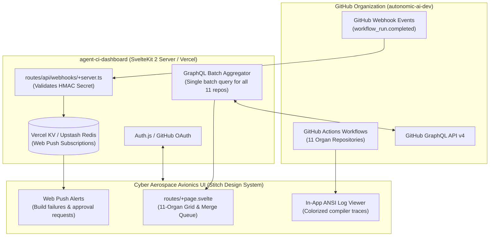

# agent-ci-dashboard — Deep Operational & Architectural Context for Agents

> **Web Mission Control, CI/CD Telemetry Console & PR Merge Queue** — In-depth architectural guide, SvelteKit 2 telemetry components, GitHub GraphQL batch queries, Webhooks, and deployment runbooks for `agent-ci-dashboard`.  
> **Ecosystem Version Baseline:** `v1.0.0-beta.3`  
> **Documentation Hub:** [https://autonomic-ai.dev/docs/telemetry](https://autonomic-ai.dev/docs/telemetry) · [Architecture Hub](https://autonomic-ai.dev/docs/architecture)  
> **Framework:** SvelteKit 2 · Vite · Tailwind CSS v4 · Vercel Adapter · Local Port `:5173`

---

## 1. Executive Summary & Biological Role

In the Autonomic 11-organ architecture, **`agent-ci-dashboard`** serves as the **Web-Based Mission Control, Visual Telemetry Console, and Pull Request Merge Queue** (analogous to the Kubernetes Web Dashboard, Argo CD UI, or GitHub Actions Mission Control).

While `agent-tui` provides an immediate in-terminal HUD for developers working locally, engineering teams operating distributed multi-agent pipelines require:
1. **Global Ecosystem Telemetry:** Real-time visibility into all 11 repositories, active GitHub Actions build matrices, and test pass/fail rates.
2. **Automated PR Merge Queue:** Tracking pull requests across multiple repositories, verifying branch protections, and monitoring dependency update workflows.
3. **In-Browser Terminal Log Streams:** Rendering raw ANSI build logs and compiler stack traces without leaving the browser interface.
4. **Instant Build Notifications:** Web push notifications the moment an automated test fails on any repository branch.

---

## 2. Core Architecture & Telemetry Pipeline



### 2.1 The Stitch Cyber Aerospace Design System
The dashboard UI strictly adheres to the Stitch "Orbital Telemetry & Avionics Interface" design language:
- **Canvas & Base:** Deep dark carbon canvas (`#080b10`) and base surface cards (`#0d1117`).
- **Telemetry Accents:**
  - Nominal Cyan (`#00f2fe`): Operational daemons, active runs, and prompt terminals.
  - Validated Emerald (`#10b981`): Passing test suites, green CI checks, and verified recipes.
  - Caution Amber (`#f59e0b`): Paused `ApprovalGate` nodes and staged candidate skills.
  - Alert Crimson (`#ef4444`): Compiler errors, CVE vulnerabilities, and failed test suites.
- **Micro-Borders & Monospace Accents:** Subtle `border-white/[0.08]` dividers and JetBrains Mono micro-typography for timestamps and hashes.

### 2.2 GraphQL Batching & Rate-Limit Optimization
Rather than making hundreds of individual REST API calls to GitHub for each repository:
- `agent-ci-dashboard` compiles a single batched GraphQL query fetching workflow statuses, commit SHAs, and active pull requests across all 11 organ repositories simultaneously.
- Consumes minimal GitHub API quota while delivering sub-second page loads.

---

## 3. Project Structure & Development Workflow

```text
agent-ci-dashboard/
├── src/
│   ├── app.css                 # Global Stitch avionics styles & Tailwind directives
│   ├── lib/
│   │   ├── components/         # Avionics telemetry cards, terminal viewer, nav
│   │   ├── server/             # GitHub GraphQL clients, webhook validators
│   │   └── types/              # Strict TypeScript definitions for CI states
│   └── routes/
│       ├── +layout.svelte      # Root avionics shell with live status beacon
│       ├── +page.svelte        # Mission Control dashboard & PR merge queue
│       └── api/                # Webhook receivers and auth handlers
├── svelte.config.js            # Vercel adapter config
└── vite.config.ts              # Vite & Tailwind CSS plugins
```

### 3.1 Local Commands
- `npm run dev` (or `bun run dev`): Start local Vite development server on `http://localhost:5173`.
- `npm run check`: Run `svelte-check` against all TypeScript and Svelte components.
- `npm run build`: Build production bundle using `@sveltejs/adapter-vercel`.
- `npm run preview`: Locally preview production server output.

---

## 4. Environment Variables Reference

| Variable | Description | Required | Example |
| :--- | :--- | :--- | :--- |
| `GITHUB_TOKEN` | Personal Access Token (`repo`, `workflow` scopes) | Yes | `ghp_...` |
| `AUTH_SECRET` | Secret key for Auth.js session encryption | Yes | `openssl rand -base64 32` |
| `AUTH_URL` | Canonical URL of the dashboard instance | Yes | `http://localhost:5173` |
| `GITHUB_CLIENT_ID` | GitHub OAuth App client ID | Yes | `Ov23...` |
| `GITHUB_CLIENT_SECRET` | GitHub OAuth App client secret | Yes | `...` |
| `KV_REST_API_URL` | Vercel KV / Upstash Redis REST URL (Web Push) | Optional | `https://...` |

---

## 5. Troubleshooting & Recovery Runbook

### 5.1 Problem: GitHub API 403 Rate Limit Exceeded
- **Cause:** `GITHUB_TOKEN` is missing or has exhausted its hourly 5,000 request limit.
- **Resolution:**
  - Verify token in `.env`: `echo $GITHUB_TOKEN`.
  - Ensure token possesses `read:org` and `repo` permissions.

### 5.2 Problem: Web Push Notifications Not Triggering
- **Cause:** Missing Vercel KV credentials or browser notification permissions denied.
- **Resolution:**
  - Check browser permission bar (must allow notifications for the domain).
  - Confirm `KV_REST_API_URL` and `KV_REST_API_TOKEN` are populated in `.env`.
